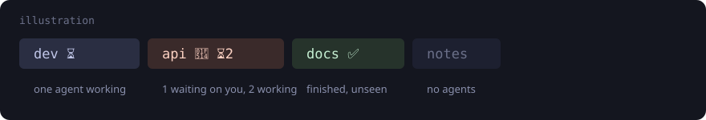

<div align="center">

# zellij-agent-status

**See which AI agent needs you, from the tab bar.**

[](https://github.com/rek/zellij-agent-status/actions/workflows/ci.yml)




</div>

Run Claude Code (or any agent) in several panes across many tabs, and you lose
track of which one is stuck on a permission prompt. This plugin puts each
agent's state on its tab. Zellij pushes tab and pane events to the plugin, so
there is no polling, no state files and no shelling out.

> In daily use on zellij 0.45.1 with Claude Code and Grok Build hooks:
> per-pane states, tab summaries, notifications-on-unfocused, the jump and
> focus-clear all work. Please open issues if something is off.

## What you get

- **Per-pane state, per-tab summary.** Several agents in one tab:
  `api 🔔 ⏳2` (one waiting, two working). A count appears only when more
  than one agent shares a state.
- **Alerts clear when you look.** Focusing the pane acknowledges it, not just
  the tab.
- **Jump key.** One keypress focuses the next waiting pane (then finished
  ones), wrapping across tabs.
- **Desktop notifications** (`notify-send`) for waiting and done, skipped for
  the pane you are already looking at.
- **Your tab names stay yours.** A manual rename becomes the new base name, and
  repainting pauses while you type one.
- **Stable tab ids.** Reordering tabs can't mislabel them.
- **Agent-agnostic.** The protocol is one `zellij pipe` line. Claude Code hooks
  are the first-class example.

## Install

Needs [Zellij](https://zellij.dev) 0.45+ and [jq](https://jqlang.github.io/jq)
(the hook script uses it).

```sh
curl -fsSL https://github.com/rek/zellij-agent-status/releases/latest/download/install.sh | sh
```

That adds an `agent-status` alias and loads it in the background. Start a new
zellij session, approve the permission prompt, and the plugin writes
`~/.config/zellij/agent-status-hook.sh` plus Claude Code / Grok hooks in
`~/.claude/settings.json`. Existing agent sessions need `/hooks`. The hook
script is version-tagged; a newer plugin rewrites it.

Grok Build loads the same `~/.claude/settings.json` hooks. `/exit` fires Stop
with `reason` `shutdown` or `channel_closed`; the hook maps those to `end` so
the tab does not stick on ✅. `SessionEnd` also sends `end`.

Optional jump key, inside `shared_except "locked"`:

```kdl
bind "Alt a" {
    MessagePlugin "agent-status" {
        name "agent-status-jump"
    }
}
```

Use that alias for the keybind too. Zellij finds the running instance by URL
*and* configuration; a `file:` URL in one block and an `https:` URL in the
other starts a second instance, and the two fight over tab names.

To install by hand instead of the one-liner: `install.sh --print` shows the
KDL. To build from source: `make install` (needs the `wasm32-wasip1` Rust
target) and point the alias at
`file:/home/you/.config/zellij/plugins/zellij-agent-status.wasm`. Zellij does
not expand `~` in some plugin paths.

### Update

```sh
curl -fsSL https://github.com/rek/zellij-agent-status/releases/latest/download/install.sh | sh -s -- --update
```

That drops Zellij's cached wasm and reloads the running plugin (or tells you
to start a new session if you are not in one). Hook install runs again when
the plugin version changed.

### Options

All optional. Set them on the alias, once:

```kdl
plugins {
    agent-status location="https://github.com/rek/zellij-agent-status/releases/latest/download/zellij-agent-status.wasm" {
        notify "waiting done"
    }
}
```

| Key | Default | Meaning |
|---|---|---|
| `notify` | `"waiting done"` | states that raise a desktop notification (`""` for none) |
| `waiting_icon` | `"🔔"` | badge for an agent waiting on you |
| `working_icon` | `"⏳"` | badge for an agent at work |
| `done_icon` | `"✅"` | badge for an agent that finished |

## What first-load registers

Each hook runs `~/.config/zellij/agent-status-hook.sh` with a different state.
The command stored in settings uses `${HOME}` so it is portable.

| Hook | Matcher | State |
|---|---|---|
| `UserPromptSubmit`, `PostToolUse` | | `working` |
| `Notification` | `permission_prompt\|elicitation_dialog` | `waiting` |
| `Stop` | | `done`, or `end` on Grok `/exit` (`shutdown` / `channel_closed`) |
| `SessionEnd` | | `end` |

The `Notification` matcher matters. Without it, Claude Code's "idle for a
while" reminder turns a finished ✅ back into 🔔 and sends a second toast.

The hook is a no-op outside zellij. `timeout` and closed stdin mean a missing
plugin can never hang the agent. By default the pipe carries no `--plugin`
URL: it broadcasts, reaching the instance started by `load_plugins` however
it is spelled. Machines that alias the plugin to a local wasm (see "To install
by hand" above) can instead create `~/.config/zellij/agent-status-plugin.url`
containing that exact URL: the hook then pipes to it alone, so a leftover
copy under a different URL can never intercept — or be launched — by the
pipe. The file is machine-local and never touched by the plugin.

## Protocol

| Pipe name | Payload | Effect |
|---|---|---|
| `agent-status` | `<pane_id>:<working\|waiting\|done\|idle\|end>` | set a pane's state (`exit` / `shutdown` / `channel_closed` also mean `end`) |
| `agent-status-jump` | none | focus the next waiting (then done) pane |

From a shell, close stdin for the jump (`zellij pipe --name agent-status-jump </dev/null`),
or `zellij pipe` waits for input. The keybind does not have that problem.

`<pane_id>` is `$ZELLIJ_PANE_ID`; `terminal_7` is accepted too.

## How it works

`src/core.rs` is pure logic (state, label composition, base-name memory, jump
order) with no zellij types, so it is tested on the host. `src/installer.rs`
builds the first-load hook script and the `settings.json` merge. `src/plugin.rs`
is the thin zellij layer. It tracks panes from `PaneUpdate`, tabs from
`TabUpdate`, and repaints names with `rename_tab_with_id`.

```sh
make test      # core unit tests
make build     # wasm32-wasip1 release build
```

## Development flow

`make install` (build from source, copy into `~/.config/zellij/plugins/`) exists
**only to test changes live before publishing**. It is not a way to run the
plugin long-term: a locally built wasm and the CI release build are different
artifacts, and a machine left on `make install` quietly runs code that was
never published. This bit once: the machine was left on a local pre-release
build, so what it ran and what GitHub had published silently diverged, and
nobody could tell from the tab bar. Don't keep a local build installed after
you're done testing.

The full loop, start to finish:

```sh
make test      # core logic, runs on the host
make install   # DEV ONLY: local build into ~/.config/zellij/plugins/

# Zellij caches compiled plugins by URL — drop the cache or the old build
# keeps running across restarts:
find ~/.cache/zellij -name '*zellij-agent-status*' -prune -exec rm -rf {} +
zellij action start-or-reload-plugin agent-status </dev/null

# ...exercise it live: run the hook by hand for a visible badge flip, and
# /hooks in a running agent to re-arm fresh hooks...

# happy? publish. The version baked into the wasm and the hook's version tag
# come from Cargo.toml, so bump it to the tag you are about to cut:
$EDITOR Cargo.toml
git add -A && git commit
git tag vX.Y.Z && git push origin main --tags
# the release workflow builds and publishes wasm + install.sh on the tag

# then put the machine back on the published artifact — never leave the
# local build in place:
curl -fsSL https://github.com/rek/zellij-agent-status/releases/latest/download/install.sh | sh -s -- --update
```

Rules of thumb:

- The machine always runs the **published release artifact**; `make install`
  is a temporary test state, undone by the update one-liner.
- Bump `Cargo.toml`'s `version` every release: the hook script's version tag
  (`# zellij-agent-status vX.Y.Z`) is `CARGO_PKG_VERSION`, and the plugin only
  rewrites a hook whose tag is older than itself.
- Zellij caches compiled plugins by URL. Replacing the wasm file changes
  nothing until the cache entry is dropped — that is what `--update` and the
  `find` above do.
- On first load the plugin writes `~/.config/zellij/agent-status-hook.sh`
  from its baked-in template and merges hooks into `~/.claude/settings.json`.
  A hand-customized hook script is therefore overwritten by the next version
  bump. The one supported machine-local knob is the optional pin file
  `~/.config/zellij/agent-status-plugin.url` — see "What first-load
  registers"; anything else belongs in `scripts/agent-status-hook.sh`.

## Prior art

Built after surveying what exists, borrowing the good ideas:
[zellij-claude-status](https://github.com/KeAiMianYang/zellij-claude-status)
(per-pane icons, rename deferral),
[zellij-attention](https://github.com/KiryuuLight/zellij-attention) (pipe
protocol, focus-clear),
[zellaude](https://github.com/ishefi/zellaude) and
[zj-radar](https://github.com/marktoda/zj-radar) (richer UIs that replace the
bar or add a sidebar). This plugin is the small one: it only touches tab names,
and adds the jump key and per-pane focus clearing.

## Roadmap

- [x] Live-session verification of states, labels, jump and focus-clear
- [x] Real Claude Code hooks
- [x] Tagged releases with prebuilt wasm
- [x] First-load hook install (script + `~/.claude/settings.json`)
- [ ] Test seam over the zellij calls so `plugin.rs` is covered
- [ ] Optional own tab-bar rendering (badges without renaming)

## Lessons from the first live run

- Zellij runs plugins as programs, so the crate is a **binary** (`main`), not a `cdylib`.
- A CLI pipe blocks its caller until the plugin releases it (`unblock_cli_pipe_input`,
  by pipe id, needs the `ReadCliPipes` permission). A hook would otherwise hang.
- Rename events land late, so zellij can report an older label; the plugin
  remembers every label it painted and never mistakes one for a manual rename.
- When a tab becomes active, zellij briefly reports the *previous* focused pane
  there. A jump claims its destination so it cannot acknowledge the wrong pane.
- Pane updates can arrive before tab updates, so the pane-to-tab map is rebuilt on both.
- A `MessagePlugin` keybind whose configuration differs from `load_plugins` starts a
  second instance. Each took the other's label for a manual rename and added a badge,
  forever. A plugin alias (`plugins { agent-status location="…" }` plus
  `MessagePlugin "agent-status"`) keeps both on the same instance. Since 0.1.1 the
  base name drops any trailing badges in the plugin's own icons, so leftovers from a
  restart converge instead.
- Zellij reports a tab's name as empty for a moment during a rename. An empty or
  badge-only name is never adopted as the base; the previous base is kept.

## Open questions

- Hook latency of `zellij pipe` on busy sessions.
- Behavior with several clients attached to one session.

## License

MIT
